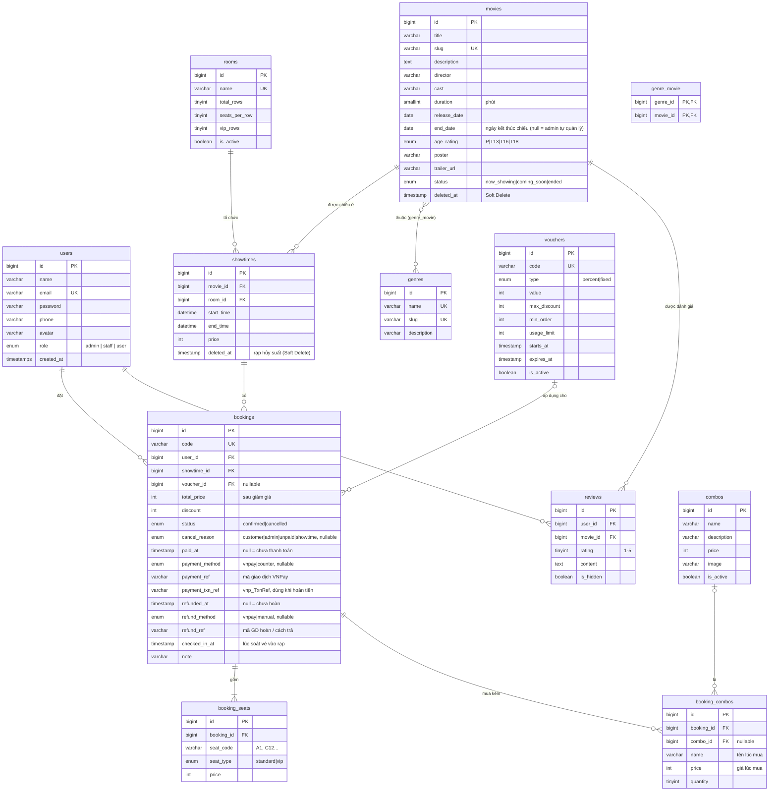
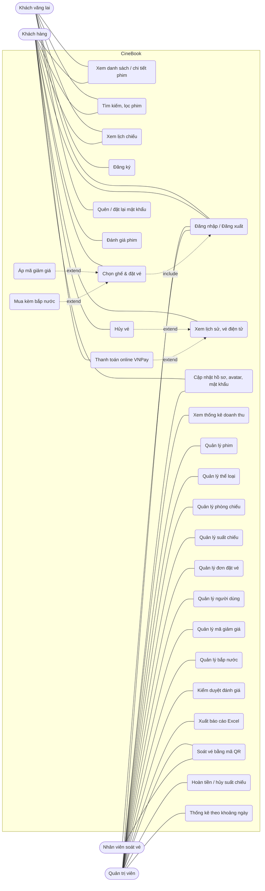

# CineBook – Tài liệu phân tích & thiết kế

> Tài liệu dùng làm nguồn cho chương "Phân tích & thiết kế hệ thống" trong báo cáo.
> Các sơ đồ viết bằng Mermaid: dán vào https://mermaid.live để xuất ảnh PNG đưa vào Word.

## 1. Mô tả đề tài

**Bài toán thực tế:** Các rạp chiếu phim quy mô nhỏ/vừa cần một website để khách xem lịch chiếu và đặt vé trước, tránh xếp hàng tại quầy, đồng thời giúp rạp quản lý phim, phòng chiếu, suất chiếu và doanh thu tập trung.

**Đối tượng sử dụng:**
- *Khách vãng lai*: xem phim, lịch chiếu, tìm kiếm.
- *Khách hàng (User)*: đặt vé, chọn ghế, quản lý vé đã đặt.
- *Nhân viên soát vé (Staff)*: chỉ soát vé cho khách vào rạp (và thu tiền vé chưa thanh toán).
- *Quản trị viên (Admin)*: quản lý toàn bộ dữ liệu nghiệp vụ và theo dõi doanh thu.

**Phạm vi:** một rạp với nhiều phòng chiếu; khách đặt vé online, thanh toán qua cổng VNPay (môi trường sandbox) hoặc trả tại quầy khi nhận vé; nhân viên soát vé bằng mã QR tại cửa phòng chiếu. Ngoài phạm vi: bán vé trực tiếp tại quầy cho khách không đặt online, nhiều cụm rạp.

## 2. Sơ đồ ERD

### Giải thích quan hệ

| Quan hệ | Loại | Eloquent |
|---|---|---|
| Phim – Thể loại | Nhiều – nhiều (bảng trung gian `genre_movie`) | `Movie::genres()` / `Genre::movies()` – `belongsToMany` |
| Phim – Suất chiếu | 1 – nhiều | `Movie::showtimes()` – `hasMany`; `Showtime::movie()` – `belongsTo` |
| Phòng – Suất chiếu | 1 – nhiều | `Room::showtimes()` / `Showtime::room()` |
| Suất chiếu – Đơn đặt vé | 1 – nhiều | `Showtime::bookings()` / `Booking::showtime()` |
| Người dùng – Đơn đặt vé | 1 – nhiều | `User::bookings()` / `Booking::user()` |
| Đơn đặt vé – Ghế | 1 – nhiều | `Booking::seats()` / `BookingSeat::booking()` |
| Người dùng / Phim – Đánh giá | 1 – nhiều (unique `user_id + movie_id`) | `User::reviews()`, `Movie::reviews()` / `Review::user()`, `Review::movie()` |
| Mã giảm giá – Đơn đặt vé | 1 – nhiều (không bắt buộc) | `Voucher::bookings()` / `Booking::voucher()` |
| Đơn đặt vé – Bắp nước đã mua | 1 – nhiều (`booking_combos` lưu tên + giá lúc mua) | `Booking::combos()` |
| Combo – Bắp nước đã mua | 1 – nhiều (combo bị xóa thì `combo_id` = null, đơn cũ vẫn giữ tên + giá) | `BookingCombo` |

**Ghi chú thiết kế:**
- Ghế không lưu thành bảng riêng mà sinh từ `total_rows × seats_per_row` của phòng (A1…J14) giúp admin đổi sơ đồ phòng dễ dàng; `booking_seats` lưu ghế đã bán kèm **giá tại thời điểm đặt** để lịch sử không bị thay đổi khi admin đổi giá.
- Khóa ngoại `showtimes → movies/rooms` và `bookings → users/showtimes` dùng `restrictOnDelete` để không thể xóa dữ liệu đã phát sinh giao dịch.
- Phim dùng **Soft Delete** để suất chiếu & vé cũ vẫn hiển thị được tên phim.
- `bookings.total_price` là số tiền khách trả **sau giảm giá**, `discount` lưu số tiền đã giảm tại thời điểm đặt; lượt dùng mã chỉ tính vé còn hiệu lực nên khách hủy vé thì mã được hoàn lượt.
- Trạng thái thanh toán tách khỏi trạng thái vé: vé "Đã xác nhận" giữ ghế ngay khi đặt, `paid_at` cho biết đã trả tiền hay chưa (online qua VNPay hoặc nhân viên xác nhận thu tại quầy). Vé đã thanh toán không cho khách tự hủy (khách đổi ý không được hoàn tiền, giống rạp thật); rạp hoàn tiền khi có sự cố và ghi lại `refunded_at`, `refund_method`, `refund_ref` (UC27).
- Suất chiếu bị rạp hủy được **xóa mềm** (`deleted_at`): tự biến mất khỏi mọi truy vấn phía khách, giải phóng phòng, còn vé cũ vẫn xem được thông tin suất (`Booking::showtime()->withTrashed()`).
- Cột `users.role` không nằm trong `$fillable`, chỉ admin đổi được vai trò, khách không tự nâng quyền qua form.
- Đánh giá chỉ được tạo khi khách có vé đã xác nhận của một suất chiếu **đã diễn ra** (`Movie::canBeReviewedBy()`), tránh đánh giá ảo.

## 3. Sơ đồ Use Case

> Khi vẽ lại bằng draw.io/StarUML: Khách hàng **kế thừa** (generalization) từ Khách vãng lai; "Đặt vé" `<<include>>` "Đăng nhập"; "Hủy vé" `<<extend>>` "Xem vé".

## 4. Đặc tả chức năng chính

### 4.1. Đặt vé (UC6)
| Mục | Nội dung |
|---|---|
| Tác nhân | Khách hàng |
| Tiền điều kiện | Đã đăng nhập bằng tài khoản role `user`; suất chiếu chưa bắt đầu, phòng đang hoạt động, phim đang chiếu |
| Luồng chính | 1. Khách chọn phim → chọn suất chiếu. 2. Hệ thống hiển thị sơ đồ ghế, ghế đã bán bị khóa. 3. Khách chọn tối đa 8 ghế, hệ thống tính tiền ngay (ghế VIP + 20.000 ₫). 4. Khách bấm "Xác nhận đặt vé". 5. Hệ thống kiểm tra hợp lệ, khóa suất chiếu, kiểm tra ghế còn trống, lưu đơn + ghế trong 1 transaction. 6. Chuyển đến trang vé điện tử với mã vé và thông báo thành công. |
| Luồng phụ | 2a. Mỗi 10 giây trang gọi AJAX lấy danh sách ghế đã bán, nếu ghế khách đang chọn bị người khác mua thì bỏ chọn và báo cho khách. 5a. Ghế vừa bị đặt / ghế không tồn tại / quá 8 ghế → quay lại trang chọn ghế kèm lỗi. |

### 4.2. Quản lý suất chiếu (UC14)
| Mục | Nội dung |
|---|---|
| Tác nhân | Quản trị viên |
| Luồng chính | Admin chọn phim, phòng, giờ bắt đầu, giá vé → hệ thống tự tính giờ kết thúc = giờ bắt đầu + thời lượng phim + 15 phút dọn phòng → lưu. |
| Ràng buộc | Giờ bắt đầu phải ở tương lai; không trùng khoảng thời gian với suất khác trong cùng phòng; suất đã có vé hoặc đã chiếu thì không cho sửa/xóa. |

### 4.3. Quản lý phim (UC11)
Thêm/sửa phim kèm upload poster (jpg/png/webp ≤ 3MB) và chọn nhiều thể loại. Ngày kết thúc chiếu (không bắt buộc, phải sau ngày khởi chiếu): qua ngày này phim tự chuyển sang "Ngừng chiếu" và không được xếp suất nữa; phim sắp chiếu tự chuyển "Đang chiếu" vào ngày khởi chiếu và được mở bán vé trước khi có suất trong 7 ngày tới. Xóa phim là **xóa mềm** (vào Thùng rác), có thể khôi phục; chỉ được xóa vĩnh viễn khi phim chưa từng có suất chiếu. Không cho xóa phim còn suất chiếu sắp tới.

### 4.4. Tìm kiếm + phân trang
Trang `/phim` tìm theo tên/đạo diễn/diễn viên, lọc thể loại, trạng thái; 8 phim/trang; dùng `paginate()->withQueryString()` để giữ từ khóa khi chuyển trang. Thanh menu có gợi ý tìm kiếm AJAX (debounce 250ms, điều hướng bằng phím mũi tên).

### 4.5. Mã giảm giá (UC19, UC20)
| Mục | Nội dung |
|---|---|
| Luồng chính | Khách nhập mã ở trang chọn ghế → AJAX kiểm tra mã và trả về điều kiện → trình duyệt tự tính lại tiền giảm khi đổi ghế → khi xác nhận, server kiểm tra lại trong transaction (khóa dòng mã) rồi lưu `voucher_id`, `discount`. |
| Ràng buộc | Mã đang bật, trong thời gian hiệu lực, còn lượt (chỉ tính vé chưa hủy), mỗi khách dùng 1 lần, đơn đạt giá trị tối thiểu; mã giảm % có mức giảm tối đa. Admin không xóa được mã đã có người dùng (chỉ tạm khóa). |

### 4.6. Bảng giá vé & ưu đãi
Giá ghế thường của mỗi suất được tính tự động theo bảng giá trong `config/cinema.php` (`Showtime::standardPriceFor`): trước 12h / 12h–17h / từ 17h, phụ thu cuối tuần, "Thứ Ba vui vẻ" đồng giá cả ngày; ghế VIP phụ thu thêm. Trang `/uu-dai` đọc cùng bảng giá này và các mã giảm giá còn dùng được (đang bật, chưa hết hạn, còn lượt) nên nội dung luôn khớp với giá thực tế khi đặt vé.

### 4.7. Thanh toán online VNPay (UC23)
| Mục | Nội dung |
|---|---|
| Tác nhân | Khách hàng, cổng thanh toán VNPay |
| Tiền điều kiện | Vé của chính khách, đang "Đã xác nhận", chưa thanh toán, suất chiếu chưa bắt đầu; đã cấu hình `VNPAY_TMN_CODE`, `VNPAY_HASH_SECRET` |
| Luồng chính | 1. Khách bấm "Thanh toán qua VNPay" trên trang vé. 2. Hệ thống tạo link VNPay (số tiền, mã giao dịch = mã vé + thời điểm, hạn 15 phút) ký bằng HMAC-SHA512 và chuyển khách sang VNPay. 3. Khách thanh toán bằng thẻ/QR ngân hàng. 4. VNPay đưa khách về `/thanh-toan/vnpay/ket-qua` và gọi IPN `/thanh-toan/vnpay/ipn`. 5. Hệ thống kiểm tra chữ ký, tìm vé, đối chiếu số tiền, khóa dòng vé rồi ghi `paid_at`, `payment_method = vnpay`, `payment_ref`. 6. Trang vé hiện "Đã thanh toán (VNPay)" kèm mã giao dịch. |
| Luồng phụ | 3a. Khách hủy giao dịch / thẻ lỗi → vé vẫn giữ, chưa thanh toán, có thể thử lại hoặc trả tại quầy. 5a. Sai chữ ký hoặc sai số tiền → từ chối (IPN trả mã 97 / 04). 5b. Kết quả đến 2 lần (trình duyệt + IPN) → chỉ ghi nhận 1 lần (IPN trả mã 02). |
| Thanh toán tại quầy | Nhân viên mở đơn trong trang quản trị, bấm "Đã thu ... ₫" để ghi nhận `payment_method = counter`. |

### 4.8. Soát vé bằng mã QR (UC24)
| Mục | Nội dung |
|---|---|
| Tác nhân | Quản trị viên / nhân viên soát vé |
| Luồng chính | 1. Nhân viên mở `/admin/soat-ve`, bật camera. 2. Khách đưa mã QR trên vé (điện thoại hoặc vé in); QR chỉ chứa mã vé. 3. Trình duyệt đọc mã, gọi AJAX tra cứu → hiện phim, suất, phòng, ghế, khách, trạng thái thanh toán kèm tiếng bíp. 4. Nhân viên bấm "Cho vào" → hệ thống khóa dòng vé, kiểm tra lại rồi ghi `checked_in_at`. 5. Vé được thêm vào danh sách "Đã soát hôm nay"; trên trang vé của khách hiện "Đã vào rạp lúc …". |
| Luồng phụ | 3a. Vé chưa thanh toán → nút đổi thành "Đã thu … ₫ & cho vào" (ghi nhận thanh toán tại quầy). 3b. Vé đã hủy / đã soát rồi / chưa tới giờ (mở trước giờ chiếu 60 phút) / suất đã kết thúc / mã không tồn tại → báo đỏ, không cho vào. 2a. Không có camera → gõ mã vé hoặc dùng máy quét mã vạch (hoạt động như bàn phím). |
| Bảng suất đang soát | Trang soát vé liệt kê suất đã tới giờ soát (mở trước giờ chiếu 60 phút đến khi kết thúc) và suất sắp mở trong 2 giờ tới, kèm số vé đã vào / đã bán / chưa thanh toán; AJAX cập nhật mỗi 30 giây, có suất vừa mở soát thì hiện thông báo + tiếng bíp; menu admin hiện số suất đang soát. |

### 4.9. Bắp nước và tự hủy vé chưa thanh toán (UC25, UC26)
| Mục | Nội dung |
|---|---|
| Bắp nước | Ở trang chọn ghế khách chọn số lượng từng combo đang bán (tối đa 10 phần/món). Server lấy giá từ CSDL (không tin giá trình duyệt gửi lên), lưu `booking_combos` kèm tên + giá lúc mua; `total_price` = tiền vé − giảm giá + bắp nước (mã giảm giá chỉ trừ vào tiền vé). Bắp nước hiện trên vé, email, chi tiết đơn và trang soát vé ("Giao bắp nước: …"). Admin CRUD combo có ảnh; combo đã bán chỉ được ngừng bán. |
| Hạn thanh toán | `Booking::paymentDeadline()` = muộn hơn trong 2 mốc: giờ chiếu − 30 phút, hoặc lúc đặt + 15 phút. Thanh toán online chỉ được trước hạn; link VNPay hết hạn không quá mốc này. |
| Tự hủy | Lệnh `bookings:release-unpaid` chạy mỗi phút: vé "Đã xác nhận", chưa thanh toán, chưa soát và đã quá hạn → khóa dòng, kiểm tra lại rồi chuyển "Đã hủy" với `cancel_reason = unpaid`, ghế mở bán lại, lượt mã giảm giá được hoàn, gửi email báo khách. `cancel_reason` cũng ghi nhận khách tự hủy / admin hủy. |

### 4.10. Hoàn tiền và hủy suất chiếu (UC27)
| Mục | Nội dung |
|---|---|
| Chính sách | Giống rạp thật: vé đã thanh toán không đổi trả khi khách đổi ý (khách không tự hủy được). Chỉ hoàn khi lỗi từ phía rạp hoặc khách trả tiền cho vé đã bị hủy. |
| Luồng chính (1 vé) | 1. Admin mở chi tiết đơn đã thanh toán, bấm "Hoàn … qua VNPay". 2. `BookingRefunder` khóa dòng vé, kiểm tra vé đã trả tiền và chưa hoàn. 3. `VnpayGateway::refund()` gọi API `merchant_webapi/api/transaction` (`vnp_Command=refund`, loại 02 = hoàn toàn phần, mã giao dịch gốc, ngày thanh toán, số tiền), ký HMAC-SHA512. 4. VNPay trả `00` → lưu `refunded_at`, `refund_method = vnpay`, `refund_ref`; vé còn hiệu lực chuyển "Đã hủy" (ghế mở bán lại). 5. Email báo khách; vé hiện "Đã hoàn tiền". |
| Luồng phụ | 3a. Vé trả tại quầy hoặc VNPay từ chối/lỗi kết nối → không đổi gì, báo lỗi; admin trả tiền mặt/chuyển khoản rồi bấm "Đã trả lại", bắt buộc ghi cách trả (`refund_method = manual`). 2a. Vé đã hoàn → chặn hoàn lần 2, không khôi phục, không xóa được. |
| Hủy suất chiếu | Admin bấm ⊗ ở danh sách suất (suất có vé, chưa kết thúc) → `ShowtimeCanceller` hủy mọi vé (`cancel_reason = showtime`), hoàn tự động vé VNPay, vé còn lại chuyển "Chờ hoàn tiền", email từng khách, rồi xóa mềm suất chiếu: suất tự ẩn khỏi trang khách, phòng được giải phóng, vé cũ vẫn xem được. |
| Chờ hoàn tiền | Vé "Đã hủy" có `paid_at` nhưng chưa `refunded_at` (VD: khách trả VNPay đúng lúc vé vừa tự hủy – `process()` vẫn ghi nhận tiền). Dashboard và trang Đơn đặt vé hiện cảnh báo + bộ lọc "Chờ hoàn tiền". |
| Ghi chú | VNPay khóa API hoàn tiền trên sandbox (mã 99); khi demo dùng hoàn thủ công. |

### 4.11. Thống kê theo khoảng ngày (UC28)
| Mục | Nội dung |
|---|---|
| Tác nhân | Quản trị viên |
| Phạm vi số liệu | Suất chiếu có giờ bắt đầu trong khoảng ngày đã chọn và đã bắt đầu (không tính suất bị rạp hủy); chỉ vé "Đã xác nhận". Mặc định từ đầu tháng tới hôm nay, tối đa 1 năm. |
| Chỉ số | Doanh thu (vé / bắp nước), số vé, số đơn, **tỉ lệ lấp đầy** = ghế đã bán / tổng ghế (`số hàng × số ghế mỗi hàng`) của các suất, tỉ lệ đơn mua kèm bắp nước. |
| Phân tích | Doanh thu theo ngày chiếu (biểu đồ cột); theo khung giờ sáng (<12h) / chiều (12–17h) / tối (17–21h) / khuya (≥21h) kèm phim bán nhiều vé nhất mỗi khung; top 10 phim theo doanh thu kèm lấp đầy; bắp nước bán chạy. |
| Cách tính | `SalesReport`: 1 truy vấn lấy từng suất kèm số ghế bán, doanh thu, tiền bắp nước (subquery `GROUP BY showtime_id` để không đếm trùng khi JOIN), sau đó cộng dồn theo ngày / khung giờ / phim bằng Collection. |

### 4.12. Đánh giá phim (UC18, UC21)
Khách đã xem phim (vé hợp lệ của suất đã chiếu) chấm 1–5 sao kèm bình luận; mỗi phim 1 đánh giá, sửa/xóa được. Trang phim hiển thị điểm trung bình, phân bố số sao. Admin lọc, ẩn/hiện bình luận vi phạm hoặc xóa.

## 5. Đối chiếu yêu cầu đồ án

| Yêu cầu (file đề) | Đáp ứng trong CineBook |
|---|---|
| Laravel mới nhất, MySQL, Eloquent, Migration, Seeder/Factory | Laravel 13, 15 migration nghiệp vụ (12 bảng), 9 seeder, 9 factory; phim thật cào từ Moveek (`movies:crawl`) |
| Blade + Bootstrap, tách giao diện user/admin | `layouts/app` (tối, rạp phim) và `layouts/admin` (sidebar) |
| ≥ 2 role, admin vào `/admin`, bảo vệ route bằng Middleware | 3 role `admin` / `staff` (nhân viên soát vé, chỉ vào được trang Soát vé) / `user`, middleware `role:` tự viết + `auth` + `guest` |
| CRUD ≥ 2 bảng có quan hệ | CRUD đủ trên Phim, Thể loại, Phòng, Suất chiếu, Người dùng, Mã giảm giá, Bắp nước (+ Đơn đặt vé, Đánh giá) |
| Tìm kiếm + phân trang giữ từ khóa | `/phim` và tất cả trang danh sách admin |
| Validation + thông báo lỗi rõ ràng | 12 Form Request + `validate()`, thông báo tiếng Việt |
| Flash message sau thêm/sửa/xóa | Toast Bootstrap ở cả 2 khu vực |
| *Mở rộng:* Upload file | Poster phim, avatar người dùng |
| *Mở rộng:* Gửi email | Quên mật khẩu (Password Broker), email vé điện tử (kèm QR) sau khi đặt, email báo vé tự hủy, email báo rạp hủy suất / hoàn tiền |
| *Mở rộng:* Xuất file, thống kê | Xuất đơn đặt vé + doanh thu theo phim ra Excel (.xlsx); trang Thống kê theo khoảng ngày (lấp đầy ghế, khung giờ, top phim, bắp nước) |
| *Mở rộng:* Tác vụ định kỳ | Laravel Scheduler: `showtimes:refresh` hằng ngày (khởi chiếu / ngừng chiếu tự động, xếp lịch 7 ngày tới, mở bán vé trước); `movies:crawl --import` hằng tuần lấy phim mới; `bookings:release-unpaid` mỗi phút tự hủy vé quá hạn thanh toán |
| *Mở rộng:* AJAX | Gợi ý tìm kiếm, cập nhật sơ đồ ghế realtime, kiểm tra mã giảm giá, tra cứu & soát vé bằng QR, bảng suất đang soát vé tự cập nhật |
| *Mở rộng:* API ngoài | Cổng thanh toán VNPay (sandbox, chữ ký HMAC-SHA512, IPN, API hoàn tiền), YouTube embed (trailer); mã QR vé tạo bằng thư viện PHP ngay trên server |
| *Mở rộng:* Responsive | Bootstrap grid, menu thu gọn, sidebar offcanvas |
| *Mở rộng:* Soft Delete, Middleware tùy chỉnh | Phim xóa mềm + thùng rác; suất chiếu bị rạp hủy được xóa mềm; `EnsureUserHasRole` |

## 6. Phân công nhóm 4 người

Chi tiết từng người phụ trách trang nào, file code nào và câu hỏi thường gặp khi bảo vệ: xem [`PHAN_CONG.md`](PHAN_CONG.md).

| Thành viên | Mảng phụ trách | Báo cáo |
|---|---|---|
| TV1 – Nhóm trưởng | CSDL (migration, model, quan hệ, seeder), cào phim Moveek, lịch chiếu tự động, Dashboard, Thống kê, xuất Excel | ERD, Công nghệ, Hướng dẫn cài đặt |
| TV2 | Đăng ký/đăng nhập/quên mật khẩu, middleware `role` (3 vai trò), hồ sơ + avatar, quản lý người dùng; mã giảm giá, bắp nước, trang Ưu đãi/Hỗ trợ | Use Case, Phân quyền |
| TV3 | Trang chủ, danh sách/tìm kiếm phim (AJAX), chi tiết phim, lịch chiếu; CRUD Phim (soft delete), Thể loại, Phòng, Suất chiếu; đánh giá phim | Mô tả chức năng xem phim + admin nội dung |
| TV4 | Chọn ghế realtime + đặt vé (transaction, khóa dòng), VNPay, hoàn tiền, vé QR, hủy/tự hủy vé, soát vé, quản lý đơn, email vé | Mô tả luồng đặt vé – thanh toán, Slide |
