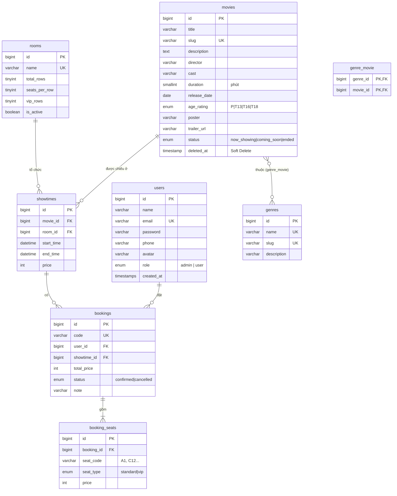
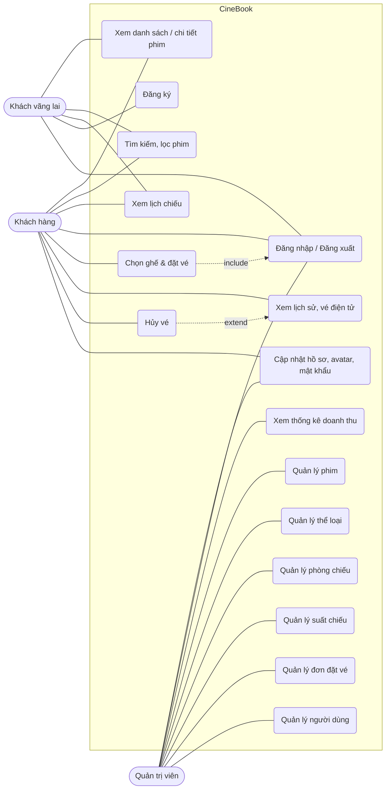

# CineBook – Tài liệu phân tích & thiết kế

> Tài liệu dùng làm nguồn cho chương "Phân tích & thiết kế hệ thống" trong báo cáo.
> Các sơ đồ viết bằng Mermaid: dán vào https://mermaid.live để xuất ảnh PNG đưa vào Word.

## 1. Mô tả đề tài

**Bài toán thực tế:** Các rạp chiếu phim quy mô nhỏ/vừa cần một website để khách xem lịch chiếu và đặt vé trước, tránh xếp hàng tại quầy, đồng thời giúp rạp quản lý phim, phòng chiếu, suất chiếu và doanh thu tập trung.

**Đối tượng sử dụng:**
- *Khách vãng lai*: xem phim, lịch chiếu, tìm kiếm.
- *Khách hàng (User)*: đặt vé, chọn ghế, quản lý vé đã đặt.
- *Quản trị viên (Admin)*: quản lý toàn bộ dữ liệu nghiệp vụ và theo dõi doanh thu.

**Phạm vi:** một rạp với nhiều phòng chiếu; thanh toán tại quầy khi nhận vé (chưa tích hợp cổng thanh toán online).

## 2. Sơ đồ ERD

### Giải thích quan hệ

| Quan hệ | Loại | Eloquent |
|---|---|---|
| Phim – Thể loại | Nhiều – nhiều (bảng trung gian `genre_movie`) | `Movie::genres()` / `Genre::movies()` – `belongsToMany` |
| Phim – Suất chiếu | 1 – nhiều | `Movie::showtimes()` – `hasMany`; `Showtime::movie()` – `belongsTo` |
| Phòng – Suất chiếu | 1 – nhiều | `Room::showtimes()` / `Showtime::room()` |
| Suất chiếu – Đơn đặt vé | 1 – nhiều | `Showtime::bookings()` / `Booking::showtime()` |
| Người dùng – Đơn đặt vé | 1 – nhiều | `User::bookings()` / `Booking::user()` |
| Đơn đặt vé – Ghế | 1 – nhiều | `Booking::seats()` / `BookingSeat::booking()` |

**Ghi chú thiết kế:**
- Ghế không lưu thành bảng riêng mà sinh từ `total_rows × seats_per_row` của phòng (A1…J14) giúp admin đổi sơ đồ phòng dễ dàng; `booking_seats` lưu ghế đã bán kèm **giá tại thời điểm đặt** để lịch sử không bị thay đổi khi admin đổi giá.
- Khóa ngoại `showtimes → movies/rooms` và `bookings → users/showtimes` dùng `restrictOnDelete` để không thể xóa dữ liệu đã phát sinh giao dịch.
- Phim dùng **Soft Delete** để suất chiếu & vé cũ vẫn hiển thị được tên phim.

## 3. Sơ đồ Use Case

> Khi vẽ lại bằng draw.io/StarUML: Khách hàng **kế thừa** (generalization) từ Khách vãng lai; "Đặt vé" `<<include>>` "Đăng nhập"; "Hủy vé" `<<extend>>` "Xem vé".

## 4. Đặc tả chức năng chính

### 4.1. Đặt vé (UC6)
| Mục | Nội dung |
|---|---|
| Tác nhân | Khách hàng |
| Tiền điều kiện | Đã đăng nhập bằng tài khoản role `user`; suất chiếu chưa bắt đầu, phòng đang hoạt động, phim đang chiếu |
| Luồng chính | 1. Khách chọn phim → chọn suất chiếu. 2. Hệ thống hiển thị sơ đồ ghế, ghế đã bán bị khóa. 3. Khách chọn tối đa 8 ghế, hệ thống tính tiền ngay (ghế VIP + 20.000 ₫). 4. Khách bấm "Xác nhận đặt vé". 5. Hệ thống kiểm tra hợp lệ, khóa suất chiếu, kiểm tra ghế còn trống, lưu đơn + ghế trong 1 transaction. 6. Chuyển đến trang vé điện tử với mã vé và thông báo thành công. |
| Luồng phụ | 2a. Mỗi 10 giây trang gọi AJAX lấy danh sách ghế đã bán, nếu ghế khách đang chọn bị người khác mua thì bỏ chọn và báo cho khách. 5a. Ghế vừa bị đặt / ghế không tồn tại / quá 8 ghế → quay lại trang chọn ghế kèm lỗi. |

### 4.2. Quản lý suất chiếu (UC14)
| Mục | Nội dung |
|---|---|
| Tác nhân | Quản trị viên |
| Luồng chính | Admin chọn phim, phòng, giờ bắt đầu, giá vé → hệ thống tự tính giờ kết thúc = giờ bắt đầu + thời lượng phim + 15 phút dọn phòng → lưu. |
| Ràng buộc | Giờ bắt đầu phải ở tương lai; không trùng khoảng thời gian với suất khác trong cùng phòng; suất đã có vé hoặc đã chiếu thì không cho sửa/xóa. |

### 4.3. Quản lý phim (UC11)
Thêm/sửa phim kèm upload poster (jpg/png/webp ≤ 3MB) và chọn nhiều thể loại. Xóa phim là **xóa mềm** (vào Thùng rác), có thể khôi phục; chỉ được xóa vĩnh viễn khi phim chưa từng có suất chiếu. Không cho xóa phim còn suất chiếu sắp tới.

### 4.4. Tìm kiếm + phân trang
Trang `/phim` tìm theo tên/đạo diễn/diễn viên, lọc thể loại, trạng thái; 8 phim/trang; dùng `paginate()->withQueryString()` để giữ từ khóa khi chuyển trang. Thanh menu có gợi ý tìm kiếm AJAX (debounce 250ms, điều hướng bằng phím mũi tên).

## 5. Đối chiếu yêu cầu đồ án

| Yêu cầu (file đề) | Đáp ứng trong CineBook |
|---|---|
| Laravel mới nhất, MySQL, Eloquent, Migration, Seeder/Factory | Laravel 13, 5 migration nghiệp vụ, 6 seeder, 5 factory |
| Blade + Bootstrap, tách giao diện user/admin | `layouts/app` (tối, rạp phim) và `layouts/admin` (sidebar) |
| ≥ 2 role, admin vào `/admin`, bảo vệ route bằng Middleware | Role `admin`/`user`, middleware `role:` tự viết + `auth` + `guest` |
| CRUD ≥ 2 bảng có quan hệ | CRUD đủ trên Phim, Thể loại, Phòng, Suất chiếu, Người dùng (+ Đơn đặt vé) |
| Tìm kiếm + phân trang giữ từ khóa | `/phim` và tất cả trang danh sách admin |
| Validation + thông báo lỗi rõ ràng | 9 Form Request + `validate()`, thông báo tiếng Việt |
| Flash message sau thêm/sửa/xóa | Toast Bootstrap ở cả 2 khu vực |
| *Mở rộng:* Upload file | Poster phim, avatar người dùng |
| *Mở rộng:* AJAX | Gợi ý tìm kiếm, cập nhật sơ đồ ghế realtime |
| *Mở rộng:* API ngoài | YouTube embed (trailer), QR code API |
| *Mở rộng:* Responsive | Bootstrap grid, menu thu gọn, sidebar offcanvas |
| *Mở rộng:* Soft Delete, Middleware tùy chỉnh | Phim xóa mềm + thùng rác; `EnsureUserHasRole` |

## 6. Gợi ý phân công nhóm 4 người

> Điền tên + MSSV. Mỗi người nên tự commit phần của mình lên GitHub để có điểm "Tham gia thực hiện".

| Thành viên | Phụ trách | File chính | Báo cáo |
|---|---|---|---|
| TV1 – Nhóm trưởng | CSDL & nền tảng: migration, model, quan hệ, seeder/factory, cấu hình; Dashboard thống kê | `database/`, `app/Models/`, `Admin/DashboardController` | ERD, Công nghệ, Hướng dẫn cài đặt |
| TV2 | Xác thực & phân quyền: đăng ký/đăng nhập, middleware `role`, Policy, hồ sơ + upload avatar; quản lý Người dùng | `AuthController`, `ProfileController`, `Middleware/`, `Policies/`, `Admin/UserController` | Use Case, Phân quyền |
| TV3 | Quản trị nội dung: CRUD Phim (poster, soft delete), Thể loại, Phòng chiếu, Suất chiếu (chống trùng giờ) | `Admin/MovieController`, `GenreController`, `RoomController`, `ShowtimeController`, `Requests/Admin/` | Mô tả chức năng admin + ảnh |
| TV4 | Giao diện khách & đặt vé: trang chủ, danh sách/tìm kiếm phim, lịch chiếu, sơ đồ ghế AJAX, vé điện tử; quản lý Đơn đặt vé | `HomeController`, `MovieController`, `BookingController`, `resources/views/`, `public/js/` | Mô tả chức năng khách + ảnh, Slide |
